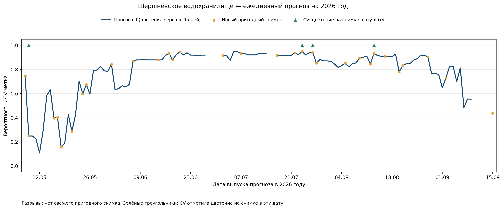

# Прогнозирование цветения водоёма по спутниковым и метеоданным

**Финалист хакатона «Космос ближе, чем кажется»** · Командный ML/CV-проект

Прототип системы раннего предупреждения для Шершнёвского водохранилища: по спутниковым снимкам и погодным данным команда оценила риск цветения на ближайшей пригодной спутниковой сцене через 5–9 дней. Прогноз предназначен для приоритизации мониторинга и отбора проб, а не для замены лабораторных измерений.

## Моя роль — ML / Computer Vision

Илья Коптевский: разметка спутниковых сцен, разработка пиксельного CV-классификатора, прогнозной модели и валидация. Проект выполнен совместно с Анастасией Кареповой (ДЗЗ и обработка данных), Юлианой Алексеевой (анализ данных) и Елизаветой Ци (экономическая оценка и презентация).

## Как устроено решение

1. **Данные:** спутниковые наблюдения Landsat 8/9 и Sentinel-2, а также ежедневные метеоданные ERA5-Land, полученные с помощью Google Earth Engine.
2. **Разметка и CV:** вручную размечены пиксели трёх классов — вода, цветение, артефакт. Для каждого семейства спутников обучен отдельный Random Forest на спектральных каналах и индексах.
3. **Целевая переменная:** пригодные сцены размечены на основе CV-оценки. Будущая сцена выбирается в интервале T+5…T+9; если её нет, целевая метка отсутствует.
4. **Прогноз:** сравнение вероятностных моделей на спутниковых, погодных и сезонных признаках с расширяющимся временным окном. Предобработка обучается внутри каждого фолда.

## Результаты и ограничения

В сравнении за 2022–2025 годы на 41 прогнозной паре Random Forest показал Brier score **0,205** против **0,263** у базовой модели с частотой положительного класса в обучении; меньше — лучше. HistGradientBoosting получил 0,238 и используется для демонстрационного графика 2026 года, а не как лучший метод по этому сравнению. Метрики относятся к CV-меткам, а не к лабораторно подтверждённому цветению.

Пиксельная проверка на отложенных сценах дала macro-F1 0,712 для Landsat и 0,619 для Sentinel-2. Выборка небольшая, снимки доступны нерегулярно, а качество меток зависит от ручной разметки и CV-модели. Пиксельная модель и порог создавались с использованием сцен разных лет, включая 2026 год: полностью независимой сквозной проверки нет. Поэтому результаты следует рассматривать как исследовательский прототип.



*Демонстрационный расчёт HistGradientBoosting; вероятность относится к CV-метке, а не к лабораторному анализу.*

## Содержимое

| Файл | Назначение |
| --- | --- |
| `01_merge_satellite_and_weather.ipynb` | Объединение спутниковых и погодных наблюдений, первичная аналитика |
| `02_cv_pixel_classifier.ipynb` | Обучение и проверка пиксельного классификатора |
| `03_cv_satellite_weather_integration_eda.ipynb` | Объединение CV-результатов, построение целевой переменной и исследование моделей |
| `04_bloom_model_clean_summary.ipynb` | Итоговое сравнение моделей, временная проверка и демонстрация прогноза |
| `shershnevskoe.py`, `download_weather_gee.py` | Выгрузка спутниковых и погодных данных из Earth Engine |
| `gee_*.js` | Разметка, проверка сцен и классификация в Earth Engine Code Editor |
| `build_cv_pixel_dataset.py`, `combine_cv_batches.py` | Сбор размеченных пикселей и объединение результатов обработки сцен |
| `pics/`, `dataCV/`, CSV в корне | Исходные экспорты разметки, результаты обработки и подготовленные таблицы |

## Запуск

Из корня репозитория создайте виртуальное окружение, установите зависимости и откройте Jupyter:

```bash
python -m venv .venv
source .venv/bin/activate
pip install -r requirements.txt
jupyter lab
```

Для знакомства с результатами начните с `04_bloom_model_clean_summary.ipynb`; для CV — с `02_cv_pixel_classifier.ipynb`. Ноутбуки используют CSV из корня репозитория и записывают результаты туда же, в том числе могут перезаписать имеющиеся файлы. Вывод ячеек очищен; для отображения результатов выполните ноутбук. Версии пакетов не зафиксированы: окружение проекта может потребовать подбора совместимых версий.

Для повторной выгрузки данных нужен доступ к Google Earth Engine, авторизация и собственный Google Cloud Project ID. Укажите его в `shershnevskoe.py` и `download_weather_gee.py`. JavaScript-скрипты предназначены для [Earth Engine Code Editor](https://code.earthengine.google.com/); для классификации необходимо загрузить таблицу пикселей в собственные Assets и указать её путь. Скрипты Earth Engine и Python обучают независимые реализации Random Forest, поэтому модели не являются побайтово идентичными.

Проект создан в рамках хакатона. Перед повторным распространением материалов и данных следует проверить условия их использования.
